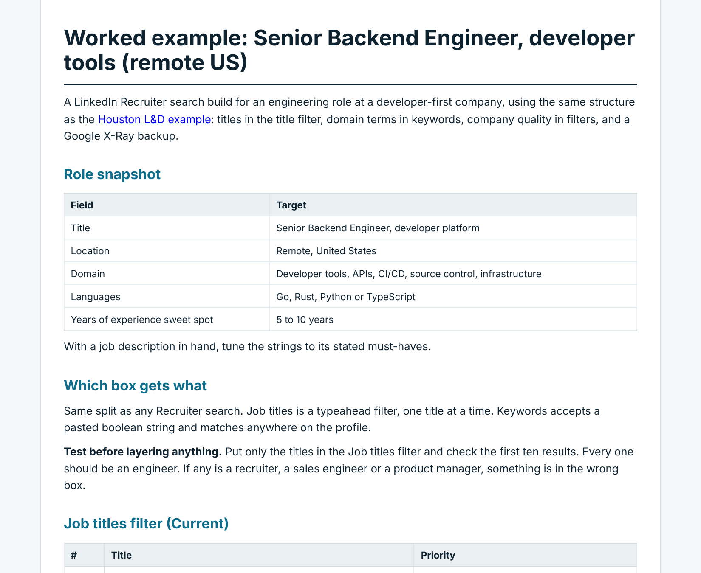

# Boolean Sourcing Library

LinkedIn Recruiter, Sales Navigator and Google X-Ray search builds for roles that are hard to source, with notes on what goes in which box and why searches return junk.

## What is in here

- [`developer-tools-engineer.md`](developer-tools-engineer.md): a worked example for a Senior Backend Engineer role at a developer-first company (remote US). It covers the title list, a two-block keyword string (stack AND domain), company filters for developer-tools companies, signal strings, Google and GitHub X-Ray, and a run order.
- [`houston-learning-development.md`](houston-learning-development.md): a worked example for a Training & Development Manager role in Houston (energy). It covers the title list, keyword strings with an exclusion block, company-quality filters, an X-Ray string, and a run order for adding filters one at a time.

## The main lessons

- **Titles and keywords go in different boxes.** In Recruiter, titles belong in the Job titles filter. A title list pasted into Keywords matches those words anywhere on a profile, which is the most common cause of junk results.
- **Fix company quality with filters, not strings.** Headcount and Industry do work no boolean string can do.
- **Add filters one at a time and watch the count.** If the number collapses, the last step you added is the problem.

## How to adapt it

Swap the title list, the industry keywords and the location for your own role. Keep the structure: titles in the title filter, keywords for domain terms, filters for company quality, and a Google X-Ray string as a backup.

## About

Written by Michele Burns, senior technical recruiter. Strings are general examples and contain no candidate or client data.
